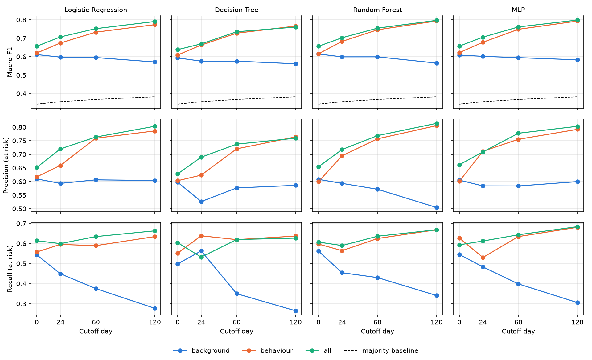
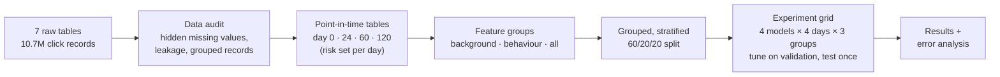
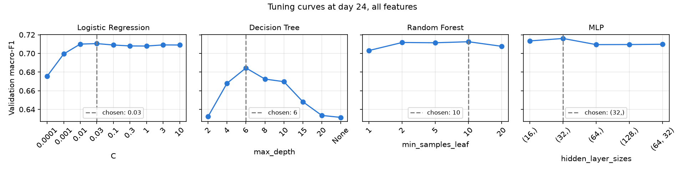
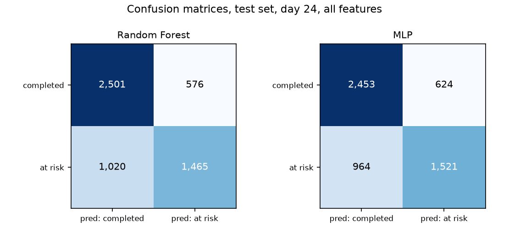

# Early Warning for At-Risk Students

**How early in an online course can we tell which students will fail or withdraw, and what
predicts it best?** This project builds leakage-safe, point-in-time datasets from 10.7 million
clickstream records in the [Open University Learning Analytics Dataset](https://archive.ics.uci.edu/dataset/349/open+university+learning+analytics+dataset)
(OULAD) and compares four models at four prediction points in a module.



## Key findings

- **Useful from day 0, better with time.** Every model beats the majority baseline from the
  first day of the module. With all features, macro-F1 rises from **0.66 at day 0 to 0.80 at
  day 120** (baseline: 0.34 → 0.38).
- **Behaviour matters more than background.** Behavioural features (clicks, resource mix,
  activity trend, early assessment results) drive the improvement over time. Background-only
  models get *worse* over time (logistic regression recall 0.54 → 0.28), because the students
  they identify best, early withdrawals, leave the data.
- **The data is the bottleneck, not the model.** Logistic regression, random forest and an MLP
  finish within **0.01 macro-F1** of each other at every prediction point. Extra model
  flexibility buys nothing measurable; only the single decision tree lags.
- **Many at-risk students are still missed at day 24** (MLP: 39%). Recall is lowest in modules
  where 96–98% of students have not submitted an assessment yet, which suggests timing
  predictions around each module's first assessment.

## Approach



**Leakage-safe by construction**
- **Point-in-time features:** each table uses only clicks and submissions dated on or before its
  cutoff, exactly what a tutor would know that day.
- **Risk set:** students who have already withdrawn are excluded, since their outcome is known.
- **No label proxies:** `date_unregistration` is filled for 99% of withdrawals, so it is used only
  to build the risk set, never as a feature.
- **Grouped split:** 3,538 students have several enrolments with correlated outcomes, so splits
  are grouped by student. Preprocessing is fitted inside each pipeline on training data only.

**Features.** 14 static *background* features (module, demographics, education, prior attempts,
credits, registration timing) and 38 time-varying *behaviour* features (VLE volume, intensity,
share of clicks per resource type, first-half vs second-half trend, and assessment submissions,
scores and timeliness).

**Models.** One hyperparameter each, chosen to span the bias–variance spectrum:

| Model | Bias / variance | Tuned | Sensitivity to tuning* |
|---|---|---|---|
| Logistic regression | High bias, low variance | `C` | 0.035 |
| Decision tree | Low bias, high variance | `max_depth` | 0.053 |
| Random forest | Low bias, variance reduced by bagging | `min_samples_leaf` | 0.009 |
| MLP | Most flexible, regularised | `hidden_layer_sizes` | 0.007 |

\*Range of validation macro-F1 across the grid at day 24 with all features.



## Results

Test macro-F1 with all features (full table: [`results/test_scores.csv`](results/test_scores.csv)):

| Model | Day 0 | Day 24 | Day 60 | Day 120 |
|---|---|---|---|---|
| Majority baseline | 0.3428 | 0.3562 | 0.3685 | 0.3831 |
| Logistic regression | 0.6565 | **0.7072** | 0.7519 | 0.7908 |
| Decision tree | 0.6381 | 0.6696 | 0.7353 | 0.7605 |
| Random forest | 0.6565 | 0.7027 | 0.7547 | 0.7969 |
| MLP | **0.6573** | 0.7062 | **0.7612** | **0.7986** |

Logistic regression, random forest and the MLP are never more than 0.01 apart, on a single
split, so no ranking among them should be read into these numbers.

Error analysis at day 24: both the best classical model (random forest, chosen on validation)
and the MLP miss about 40% of at-risk students, and make the same kinds of errors.



## Repository layout

```
├── src/oulad/
│   ├── data.py          # load the raw CSVs, build the enrolment table
│   ├── features.py      # FeatureBuilder: point-in-time tables, risk set, feature groups
│   ├── modelling.py     # grouped stratified split, preprocessing, metrics
│   ├── models.py        # model specs and hyperparameter grids
│   ├── experiment.py    # ExperimentRunner: tune on validation, refit, test once
│   ├── diagnostics.py   # data audit (hidden missing values, leakage, grouping)
│   ├── plotting.py
│   └── pipeline.py      # run_pipeline(): the whole study in one call
├── notebooks/oulad_at_risk_prediction.ipynb   # walkthrough with results
├── scripts/run_experiments.py                 # reproduce every number and figure
├── tests/                                     # unit tests on synthetic data
├── results/  figures/  docs/data-dictionary.md
```

## Quickstart

```bash
pip install -r requirements.txt
pip install -e .            # optional: makes `import oulad` work anywhere
```

Download OULAD from the [UCI repository](https://archive.ics.uci.edu/dataset/349/open+university+learning+analytics+dataset)
and put the seven CSVs in `data/`. Then:

```bash
python scripts/run_experiments.py   # about 6 minutes; writes results/ and figures/
pytest                              # unit tests, no download needed
```

Or open the notebook. Use the pinned versions: scikit-learn determines the train/validation/test
split, so other versions give slightly different numbers.

## Limitations and next steps

- **Each prediction point is evaluated on different students** (the risk set shrinks), so
  comparisons across days mix "more information" with "different population". Evaluating every
  day on students still enrolled at day 120 would separate the two.
- **Default 0.5 threshold.** Missing an at-risk student costs more than a false alarm; choosing the
  threshold on validation for a target recall would suit an early-warning system better.
- **Clicks measure activity, not learning**, and say nothing about circumstances outside the course.
- **Module-specific prediction points**, aligned with each module's first assessment, could
  recover the students missed at day 24.

## Team

Built as a team project for COMP90049 Introduction to Machine Learning at the University of
Melbourne (2026), then refactored into a package.

- **Guangyu Feng:** classical models, shared experiment framework, results and error analysis,
  integration and refactoring
- **Wai Chun Tam:** data audit, preprocessing and feature engineering
- **Xinyan Jiang:** neural network (MLP)

## Data and citation

OULAD is published by The Open University under
[CC BY 4.0](https://creativecommons.org/licenses/by/4.0/). The data is not included in this
repository.

> Kuzilek, J., Hlosta, M., & Zdrahal, Z. (2017). Open University Learning Analytics dataset.
> *Scientific Data*, 4, 170171.

Code is released under the [MIT License](LICENSE).
