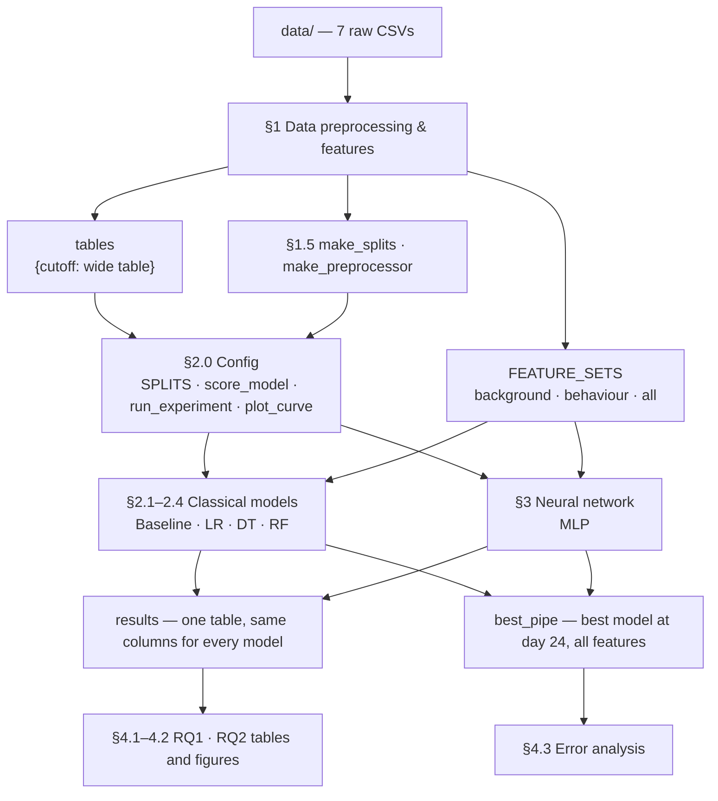
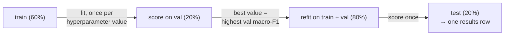

# COMP90049 Assignment 2

Predicting at-risk students from the Open University Learning Analytics dataset.

- **Report (Overleaf):** _paste link_
- **Dataset:** https://analyse.kmi.open.ac.uk/open_dataset
- **Paper:** Kuzilek, Hlosta & Zdrahal (2017), *Scientific Data* 4:170171

**RQ1** — How early in a course can at-risk students be identified?

**RQ2** — Can behavioural data predict the final outcome better than background data?

## Files

| File | What it is |
|---|---|
| `main.ipynb` | **The file we submit.** Runs top to bottom, produces every number in the report |
| `work_Guangyu.ipynb` | Guangyu's scratch space |
| `work_WaiChun.ipynb` | Wai Chun's scratch space |
| `work_Xinyan.ipynb` | Xinyan's scratch space |
| `docs/` | Dataset notes, exported results and figures |
| `data/` | The seven CSVs. Gitignored — never commit these |

## How the deliverable code works

We submit **one notebook, `main.ipynb`**. The spec requires it to reproduce every number in
the report, including data processing, models, visualisation and evaluation. It reads the
raw CSVs from `data/`, builds everything **in memory** and runs top to bottom.

- **Nothing is written to disk.** Sections pass data to each other through variables
  (`tables`, `FEATURE_SETS`, `SPLITS`, `results`), not files. It does not use `processed/`,
  `manifest.json` or `import a2_common`.
- **Status (13 Oct):** §0–§2 are migrated and verified. A full run takes about 4 minutes and
  reproduces the work-file results exactly. §3 and §4 are still to come.

### Sections and owners

```
0. Setup                         imports, SEED, KEY, CUTOFF_DAYS, TARGET, GROUP_COL
1. Data Preprocessing & Feature Engineering                      ── Wai Chun
   1.1 Load raw CSVs
   1.2 Evidence for the report (hidden "?" missing values, leakage, grouped structure)
   1.3 Clean studentInfo, build the target
   1.4 Aggregate per cutoff, risk set → tables; feature sets → FEATURE_SETS
   1.5 Shared harness: make_splits, describe_splits, make_preprocessor
2. Classical ML Models & Evaluation                              ── Guangyu
   2.0 Config: SPLITS, evaluate / score_model, run_experiment(), plot_curve()   ← also used by §3
   2.1 Majority baseline
   2.2 Logistic Regression   (tune C)
   2.3 Decision Tree         (tune max_depth)
   2.4 Random Forest         (tune min_samples_leaf)
   2.5 Delivery              combined results table + best model for error analysis
3. Neural Network Model & Evaluation                             ── Xinyan
   3.1 MLP                   (tune e.g. alpha / hidden size)
4. Results: Research Questions                                   ── owner to confirm
   4.1 RQ1: all models × all cutoffs   → table + line figure
   4.2 RQ2: feature sets × models      → table + bar figure
   4.3 Error analysis                  → confusion matrix + specific cases
```

### How data and results flow



- **§1 and §2.0 come first and are shared.** §2 and §3 use the same splits, preprocessing,
  metrics and training loop, which is what the rubric's validation-design criterion checks.
- **§3 reuses §2.0**, which runs before it in the same notebook. Don't redefine `SPLITS` or
  `run_experiment()` in §3.
- **§4 is the only place the models meet.** It combines their results and trains nothing.

### What one model run does

Every model is trained on the full **experiment grid**: 4 cutoffs × 3 feature sets = 12 cells,
each tuned and tested separately. One call to `run_experiment()` covers all 12.

```
                 day 0      day 24     day 60     day 120     ← RQ1 reads across
background        [ ]        [ ]        [ ]        [ ]
behaviour         [ ]        [ ]        [ ]        [ ]
all               [ ]        [★]        [ ]        [ ]
      ↑
 RQ2 reads down        ★ = main cell (day 24, all features): also keeps the
                           tuning curve and the fitted model
```

Inside **every** cell, the same protocol runs. The test set never influences any choice:



### Interfaces that must match across sections

**The training loop** (defined once in §2.0, used by every model):

```python
rows, curve, best_pipe = run_experiment(name, model, param, values,
                                        cutoffs=CUTOFF_DAYS, feature_sets=None)
```

| Argument | Meaning | Example |
|---|---|---|
| `name` | Label in the `model` column | `"LogisticRegression"` |
| `model` | Untrained scikit-learn estimator (cloned for every fit) | `LogisticRegression(max_iter=2000, random_state=SEED)` |
| `param`, `values` | The one hyperparameter to tune, and the values to try | `"C"`, `[0.0001, 0.001, …, 10]` |
| `cutoffs` | Which cutoffs to run; default all four (use `[24]` while testing) | `[0, 24, 60, 120]` |
| `feature_sets` | Which feature sets to run; default all three | `None` |

| Returns | Content |
|---|---|
| `rows` | One dict per cutoff × feature set: the chosen value and 6 test metrics |
| `curve` | `{value: validation macro-F1}` for the main cell, used for the tuning-curve figure |
| `best_pipe` | The fitted final model for the main cell, used for error analysis |

**Results columns:** `model, cutoff, feature_set, best_param, accuracy, precision, recall, f1, macro_f1, roc_auc`

**Feature-set names:** `background` (14 columns), `behaviour` (38), `all` (52)

> `run_experiment()` relies on scikit-learn's `clone`, `set_params` and `predict_proba`. A
> PyTorch or Keras model needs its own loop that follows the same protocol and returns the
> same columns.

### Template for a model section

Each model section has the same three parts, so the notebook reads consistently:

```
### 2.x Model name
#### 2.x.1 Train and tune, and produce evaluation results on test    rows, curve, pipe = run_experiment(...)
#### 2.x.2 Sample results                                            test macro-F1 table: cutoff × feature set
#### 2.x.3 Tuning curve                                              validation score vs hyperparameter + chosen value per cell
```

```python
# 2.2.1 Train and tune
log_rows, log_curve, log_pipe = run_experiment(
    "LogisticRegression", LogisticRegression(random_state=SEED, max_iter=2000),
    "C", [0.0001, 0.001, 0.01, 0.03, 0.1, 0.3, 1, 3, 10])

# 2.2.2 Sample results
pd.DataFrame(log_rows).pivot(index="cutoff", columns="feature_set", values="macro_f1")

# 2.2.3 Tuning curve
plot_curve("LogisticRegression", log_curve, "C")
```

Model labels are spelled out in full (`"LogisticRegression"`, `"DecisionTree"`, `"RandomForest"`),
so §3 should follow the same style (e.g. `"MLP"`).

### Rules for code that goes into `main.ipynb`

| Rule | Why |
|---|---|
| Use the shared helpers; never write your own split, scaler or metrics | Every model must use the same validation |
| Validation chooses, test is scored once | A test set that influences choices gives an inflated score |
| Pass `SEED` to every estimator and split | Same numbers on every run |
| Each cutoff is a separate dataset; never pool cutoffs | Pooling puts the same student in several rows and mixes prediction times |
| Same package versions: **scikit-learn 1.9.1, pandas 3.0.6** | A different version produced a different split before |
| Write nothing to disk; pass data between sections in memory | Reading files left over from an older run breaks reproducibility. The raw click table is freed (`del student_vle, asm`) once the wide tables are built |
| Define each shared object once (`FEATURE_SETS` in 1.4.5, `SPLITS` in 2.0.1) | A second definition silently overwrites the first |
| English comments and output | The markers read the notebook |

### From work files to `main.ipynb`

Each work file uses the **same section numbers** as `main.ipynb`, so merging is copy and
paste in order:

| Work file | Becomes | Not copied |
|---|---|---|
| `work_WaiChun.ipynb` | §1 ✅ migrated | Plan / notes cells, setup cell, `to_csv` / manifest saving, 1.6.1 |
| `work_Guangyu.ipynb` | §2 ✅ migrated | Plan & hints cell, setup cell, 2.0 Config (now in `main.ipynb` §2.0), `to_csv` line |
| `work_Xinyan.ipynb` | §3 | Plan / notes cells, setup cell |

When pasting work-file code, translate the `a2_common` calls:

| Work file | `main.ipynb` |
|---|---|
| `import a2_common as A2` | *(remove: everything is already defined above)* |
| `A2.score_model(...)`, `A2.make_splits(...)`, … | `score_model(...)`, `make_splits(...)`, … |
| `A2.load_table(24)` | `tables[24]` |
| `A2.feature_cols("baseline")` / `("behaviour")` / `("engineered")` | `FEATURE_SETS["background"]` / `["behaviour"]` / `["all"]` |
| `A2.SEED`, `A2.TARGET` | `SEED`, `TARGET` |

### Model choice and the bias–variance spectrum

The spec asks for algorithms that "cover some spectrum from high-bias/low-variance to
low-bias/high-variance". All four models below are taught in the subject, so each result
can be explained with lecture theory.

| Model | Lecture | Bias / variance | Why | Tuned (grid search on validation macro-F1) |
|---|---|---|---|---|
| Logistic Regression | Wk 4 | **High bias, low variance** | Linear decision boundary only; L2 regularisation further limits variance | `C` ∈ {0.0001, 0.001, 0.01, 0.03, 0.1, 0.3, 1, 3, 10} |
| Decision Tree | Wk 3 | **Low bias, high variance** | Can split until leaves are pure; lecture lists "prone to overfitting" | `max_depth` ∈ {2, 4, 6, 8, 10, 15, 20, None} |
| Random Forest | Wk 8 | **Low bias, reduced variance** | Bagging + random feature subsets average many trees, which cuts variance | `min_samples_leaf` ∈ {1, 2, 5, 10, 20} (`n_estimators=100`, fixed) |
| MLP (neural network) | Wk 7–8 | Low bias, high variance | Hidden layers can approximate non-linear functions | e.g. hidden size / `alpha` |

**Why these three:**

- **LR and DT are the two ends of the spectrum**: a rigid linear boundary vs a flexible tree
  that can memorise the training set.
- **RF is the DT with its variance removed.** The DT → RF gap measures what bagging buys
  (Wk 8: "bagging reduces variance"). That is a direct, testable theory–practice link.
- **Each tuning knob moves its model along the spectrum.** Small `C` or small `max_depth`
  means more bias; large values mean more variance. Plotting train vs validation score
  against `max_depth` reproduces the lecture's underfitting/overfitting curve on our own data.

**Not chosen:**

- **Naive Bayes:** its feature-independence assumption is clearly broken here (total clicks,
  active days and click halves are strongly correlated), and `GaussianNB` has only
  `var_smoothing` to tune.
- **KNN:** distances are unreliable across ~60 mixed one-hot, ratio and count features
  (curse of dimensionality), and prediction is slow at ~20k training rows.
- **SVM:** with an RBF kernel it scales poorly to ~20k rows × 36 grid cells; linear SVM
  would duplicate LR's position on the spectrum.
- **Gradient boosting:** strong, but not taught (only AdaBoost is), so its results would be
  harder to explain with course theory.

## Setup

```bash
git clone <repo url>
cd comp90049-a2
pip install pandas==3.0.6 scikit-learn==1.9.1 numpy matplotlib seaborn jupyter nbstripout
nbstripout --install
```

Use **scikit-learn 1.9.1** exactly. Tested on 13 Oct: the scikit-learn version alone decides
the train/val/test split (1.7.2 produces a different one), so on another version nobody's
numbers match. pandas, numpy and scipy don't affect the split. To check your environment:

```python
import sklearn; print(sklearn.__version__)            # must print 1.9.1
```

Then download the dataset from the link above, unzip, and put the seven CSVs directly
in `data/`. Open your own `work_<name>.ipynb` and check you can load a CSV from `data/`.

`nbstripout` strips notebook outputs on commit. Without it, two people running the same
notebook conflicts on every cell. It is the one setup step worth not skipping.

## How we work

**Work in your own file.** `work_Guangyu`, `work_WaiChun` and `work_Xinyan.ipynb` belong
to one person each, so they never conflict. Commit to them as often as you like.

**`main.ipynb` is shared, so one person at a time.** Say so in the group chat before you
start editing it, and push as soon as you're done. When a piece of your work is finished,
paste it into the section it belongs to and strip out the exploratory parts.

**The setup cell is the source of truth.** `SEED`, `CUTOFF_DAYS` (the cutoffs RQ1 compares)
and `KEY` go at the top of `main.ipynb`. Copy that cell into your work file rather than writing your own.
If it changes, whoever changed it tells the group and everyone re-copies — otherwise we
end up with results computed under different settings and no way to tell.

**Pull before you start, push when you stop.** Every session.

**Commit your own work.** Don't send files to one person to push. The commit history is
the evidence for the Stage III peer evaluation.

Commit messages: short, say the area. `features: clicks by activity type`,
`eda: class balance plot`, `main: merge Wai Chun's tuning section`.

## Progress

Tick these off as they land.

- [x] Data downloaded, row counts confirmed
- [x] Unique students vs 32,593 rows — the unit is a student-presentation (enrolment); 3,538 students repeat
- [x] Target decided: binary `at_risk` (Fail + Withdrawn vs Pass + Distinction)
- [x] Cutoff days to compare for RQ1 decided: 0 / 24 / 60 / 120
- [x] Split decided and justified: 60/20/20, grouped by student, stratified on `at_risk`
- [x] Modelling table built (`tables` in `main.ipynb` §1.4)
- [x] Shared evaluation function works — same folds, same metrics, any model (`run_experiment()`)
- [x] Baseline computed
- [ ] Four models trained — LR, DT, RF done; MLP pending (§3)
- [ ] All four tuned, search ranges logged — LR, DT, RF done; MLP pending
- [ ] RQ2: behavioural-only vs background-only feature sets compared — done for LR, DT, RF; MLP pending
- [ ] Error analysis done
- [ ] Results frozen, everything exported to `docs/`
- [ ] Report drafted
- [ ] `main.ipynb` runs clean on a fresh kernel and matches the report

## Dates

| Date | What |
|---|---|
| Fri 3 Oct | Data checks done, target and cutoff decided |
| Tue 7 Oct | Shared evaluation function working |
| Tue 14 Oct | Results frozen |
| Fri 16 Oct | Report + notebook submitted — no extensions |
| Fri 23 Oct | Peer evaluation and self-reflection |

## Before submitting

Restart the kernel, run `main.ipynb` top to bottom, and check the numbers match the
report. A notebook that disagrees with the report can zero the report component.
